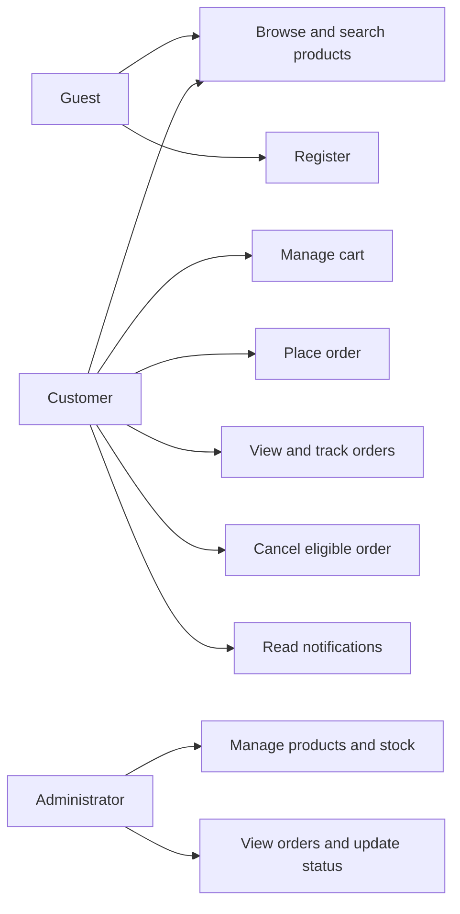
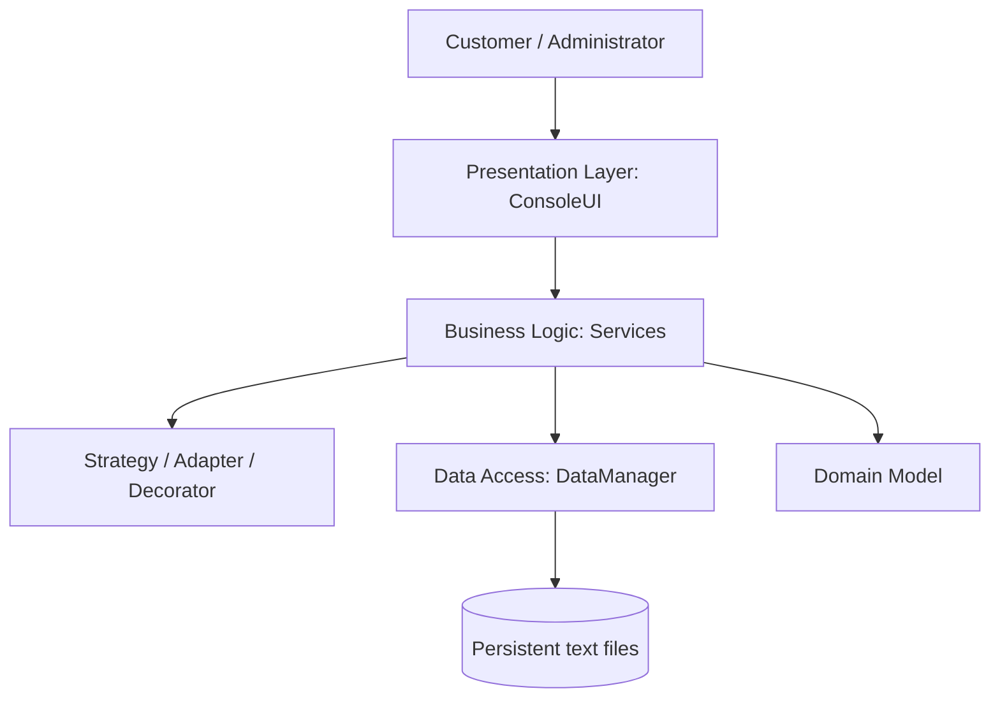
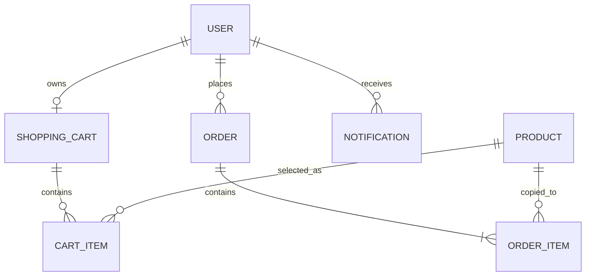
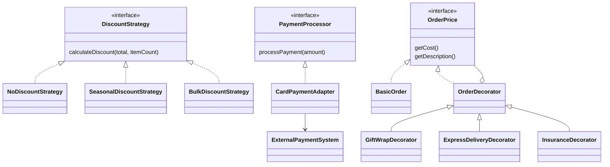

# Project Diagrams

## Use-case diagram

## Architecture diagram

## Entity relationship diagram

## UML class diagram

The complete UML source is in `diagrams/class-diagram.mmd`. The most important pattern relationships are shown below.

